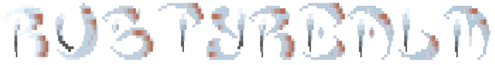

<p align="center">
  
</p>

<p align="center"><em>A cross-platform Rust reimplementation of Final Realm, the Windows Batch text RPG.</em></p>

Rusty Realm (RRealm) is a Rust-based reimplementation of [Final Realm](https://finalrealm.weebly.com/), a text-driven RPG originally distributed as a Windows Batch script. It preserves the original game's recognisable loop—building a character, fighting monsters, improving skills, trading equipment and items, and tackling the Stronghold—while replacing the Batch implementation with a structured Rust application.

This is an ongoing revival, not a claim that every original feature has been reproduced or that every new system is finished. The notes below describe what is present in the current source tree, rather than a promise of complete feature parity.

## What Rusty Realm improves

### A more portable foundation
- **Rust instead of Windows Batch.** The game is implemented in Rust 2021 and uses terminal libraries rather than relying on Windows command scripts. It is designed for cross-platform terminal use; actual behaviour still depends on the target terminal and operating system.
- **A structured terminal interface.** Shared menus support keyboard and mouse selection where terminal mouse events are available, and hit regions follow the current layout and scroll position. Selected, disabled and unavailable entries have distinct cues; blocked actions explain why they cannot be chosen. On larger terminals, the interface can show a character-status sidebar with health and experience gauges; smaller terminals use more compact layouts.
- **A line-input fallback for restricted terminals.** When standard input is not a terminal or raw-mode setup fails, menus fall back to numbered options and line-based prompts. For wrappers that accept whole submitted lines but cannot deliver live key events (including some a-Shell configurations), set `RUSTYREALM_INPUT_MODE=text` before launching, for example `RUSTYREALM_INPUT_MODE=text cargo run`. In this mode, characters entered into masked prompts may be echoed by the terminal.
- **Separated game systems.** Combat, combat calculations, save handling, quests, skills, crafting, inventory, shops, banking, economy, progression and the terminal UI live in separate modules, making the code easier to extend than a single large Batch script.
- **More deliberate save handling.** Player data is serialised to JSON under the platform's application-data directory. Saves use a versioned envelope, a SHA-256 checksum, a backup, and temporary-file replacement. If the primary save cannot be read, the loader can attempt to recover from a valid backup.
- **Local accounts and optional passwords.** The centred startup screen separates active local accounts from account actions, and shows the original porting-work ASCII banner only when the terminal has enough room. Selecting an account opens an overview of character progression and the current party before the player confirms entry. Escape navigates back to the previous account/menu choice and never silently activates an arbitrary final menu item; Enter confirms the highlighted selection. In text-only fallback mode, entering `0` returns to an explicit Back/Return/Cancel option. The Manage Accounts screen can delete local saves; password-protected accounts require their existing password before deletion, while passwordless or legacy accounts require exact account-name confirmation. New accounts may be passwordless; the game warns that anyone with access to the computer and its local save files can then open them. Password-protected accounts continue to store Argon2 hashes separately from player data.

### Gameplay retained and expanded
- **Character progression and equipment.** Combat levels, experience, health, weapon tiers, armour tiers and inventory remain central to progression. Rusty Realm's typed data model also includes additional weapon tiers beyond the original script's listed equipment.
- **A richer combat model.** In addition to ordinary wandering encounters and the Stronghold boss, the code includes critical hits, stamina and mana, abilities, damage types, resistances and vulnerabilities, status effects, and multiple phases for Lacoyx. These mechanics are implemented in the combat engine; this does not imply that every encounter uses every mechanic.
- **Skills and crafting.** The six familiar skills—Woodcutting, Cooking, Fishing, Mining, Smithing and Thieving—remain. Skill actions grant experience, and the Skill Plot offers recipes such as smelting ingots, forging an iron sword, fletching a bow, cooking food and preparing a gourmet feast, subject to ingredients and skill requirements.
- **More progression goals.** The Quest Hall has daily objectives, progress tracking, claimable rewards and world-event information. Separate achievement and mastery menus track milestones, unlock titles or themes, and let eligible characters equip perks.
- **More encounter variety.** Wandering can produce standard fights, stronger elite encounters, travelling merchants and treasure finds. The Stronghold includes its original-style run towards Lacoyx as well as an Endless Gauntlet with escalating waves and modifiers.
- **Trading and banking.** Weapon and armour shops, the Legend's Store, Trading Post/general-store buying and selling, the Smuggler, and RealmBank are available through menus. The economy also tracks trading activity and supports time-limited world-event price effects.

## What is implemented—and what is not implied

The list above reflects systems represented in the current code and reachable through the game's menus. It should not be read as evidence that Rusty Realm is feature-complete, fully balanced, or an exact reproduction of the original. Some systems are narrower than their names may suggest: for example, the current crafting system has a defined set of recipes, and the current achievements list is finite. Planned features and future expansions are not included as current capabilities.

Legacy saves that do not contain a verifiable password hash require an explicit migration step: the old password cannot be authenticated retroactively. Migration asks the player to choose a new password; it does not silently treat an entered password as proof of ownership.

## The original game

Visit [Final Realm's original website](https://finalrealm.weebly.com/) for the game that inspired this project. Rusty Realm aims to preserve its core identity while building on a more maintainable codebase.

## Development

Rusty Realm uses Rust 2021. To compile and run the test suite locally:

```sh
cargo build
cargo test
```

The project is a work in progress. Feedback and bug reports should distinguish verified current behaviour from desired future changes.
